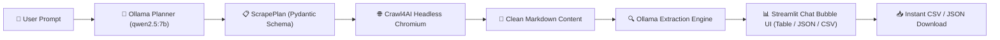

# 🕸️ Conversational AI Web Scraper

> **100% Free & Open-Source Conversational Real-Time Web Scraper** powered by **Streamlit**, **Crawl4AI**, and **Local Ollama (Qwen 2.5)**.

An autonomous, ChatGPT/Gemini-style web scraping application. Simply describe what you want to scrape in natural language (URL, desired fields, output format), and the app plans the task, crawls the webpage with headless Chromium, extracts validated structured records using a local LLM, and lets you download CSV or JSON with one click.

---

## 🌟 Key Features

- **🗣️ Natural Language Interface**: No code, XPath, or CSS selector tuning required. Just type: *"Scrape top 10 books from books.toscrape.com with title, price, and rating as a table"*.
- **🧠 Autonomous Planning**: Converts free-form prompts into validated Pydantic `ScrapePlan` schemas with auto-sanitized URLs, snake_case fields, and formatting rules.
- **⚡ High-Performance Headless Crawling**: Powered by **Crawl4AI** with Chromium, executing JavaScript and extracting clean Markdown while preserving attributes and numbers.
- **🔒 100% Local & Free Inference**: Driven by **Ollama** running `qwen2.5:7b` locally — zero API fees, complete data privacy, and unlimited scrapes.
- **📊 Multi-Format Display**: View records as interactive tables (`st.dataframe`), syntax-highlighted JSON (`st.json`), or CSV previews.
- **📥 One-Click Export**: Export any scraped dataset in chat history as CSV or JSON with clash-free download buttons.
- **⚙️ Live Background Telemetry**: Collapsible real-time `st.status` indicator displaying each step of the pipeline.

---

## 🏗️ Architecture Pipeline



---

## 🚀 Quickstart Guide

### 1. Prerequisites
- **Python**: 3.10+ (tested on Python 3.13 Apple Silicon M4)
- **Ollama**: Installed and running locally ([Download Ollama](https://ollama.com/))

### 2. Pull the Local Model
Start Ollama and pull `qwen2.5:7b`:
```bash
ollama serve
ollama pull qwen2.5:7b
```

### 3. Clone & Setup Virtual Environment
```bash
git clone https://github.com/shavilya/Conversational_AI_Scrapper.git
cd Conversational_AI_Scrapper/oss-realtime-scraper/ai-chat-scraper

# Create and activate virtual environment
python3 -m venv venv
source venv/bin/activate

# Install dependencies
pip install -r requirements.txt

# Install Playwright browser binaries
crawl4ai-setup
```

### 4. Launch the Application
```bash
streamlit run app.py
```
Open **[http://localhost:8501](http://localhost:8501)** in your browser!

---

## 💡 Example Prompts

| Goal | Example Prompt |
| :--- | :--- |
| **📚 Books to Scrape** | `Scrape the top 5 books from https://books.toscrape.com with title, price, and availability in a table` |
| **💬 Quotes** | `Extract 5 quotes from https://quotes.toscrape.com with quote, author, and tags as json` |
| **🚀 Hacker News** | `Scrape top 10 stories from https://news.ycombinator.com with title and link in csv format` |
| **💻 GitHub Trending** | `Extract trending repositories from https://github.com/trending with repo_name, description, and stars as a table` |

---

## 📁 Repository Structure

```text
Conversational_AI_Scrapper/
├── .gitignore
├── README.md
└── oss-realtime-scraper/
    └── ai-chat-scraper/
        ├── app.py              # Streamlit conversational frontend & chat loop
        ├── scraper_engine.py   # Ollama planner, Crawl4AI crawler & JSON extractor
        └── requirements.txt    # Pinned dependencies
```

---

## 🛡️ License

MIT License. Open-source and free for commercial and personal use.
